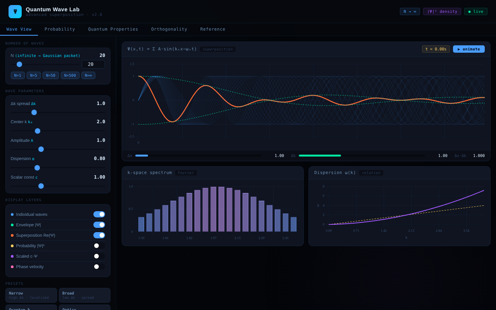

<div align="center">

# 🌊 Quantum Wave Lab

An interactive lab for wave superposition and Fourier series: build a wave packet from N waves and explore its probability density, quantum properties and orthogonality.

[](https://meshannawod.github.io/quantum-mechanics-learning-resources/)

   



</div>

## Features

- **Wave view:** add up N = 1, 5, 50, 500 or ∞ component waves and animate the result
- **Probability:** the probability density |ψ|² of the superposed wave
- **Quantum properties:** expectation values and spreads, linked to the uncertainty principle
- **Orthogonality:** check numerically that the basis functions are orthogonal
- **Reference:** the formulas used, in one place
- Sliders for amplitude, frequency spread and the other parameters, with a live k-space spectrum

## Run locally

Download the repository and open `wave_superposition.html` in a browser. Chart.js loads from a CDN.

## Files

```text
index.html               opens the lab (GitHub Pages home)
wave_superposition.html  the Quantum Wave Lab
docs/                    screenshot
```

See also **[physics-learning-resources](https://github.com/MeshanNawod/physics-learning-resources)** for the hydrogen atom and quantum lab simulations.

## Author

Made by **Meshan Nawod**, Physics undergraduate at the University of Peradeniya · [Portfolio](https://meshannawod.github.io/) · [GitHub](https://github.com/MeshanNawod)

## License

MIT. See [LICENSE](LICENSE).
